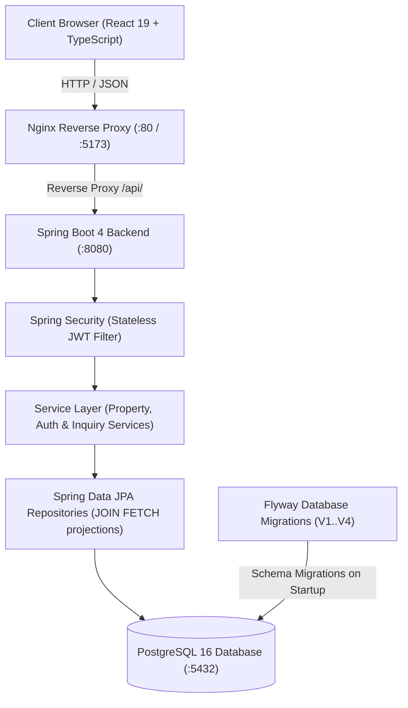

# RentFlow 2.0 — Rental Property Management Platform

[](https://github.com/iiitsourabh-a11y/RentFlow2.0/actions/workflows/ci.yml)
[](https://openjdk.org/projects/jdk/21/)
[](https://spring.io/projects/spring-boot)
[](https://www.postgresql.org/)
[](https://react.dev/)
[](https://www.typescriptlang.org/)
[](LICENSE)

A production-grade, secure, full-stack rental property management platform built with **Java 21**, **Spring Boot 4**, **PostgreSQL 16**, and **React 19 / TypeScript**. Designed to demonstrate enterprise backend design, stateless JWT security, role-based authorization, database migration hygiene, N+1 query elimination, and automated integration testing.

---

## 🏗️ System Architecture



---

## 🛠️ Technology Stack

### Backend
- **Java 21 (LTS)** — Modern language features including Records, Pattern Matching, and Sealed Classes.
- **Spring Boot 4.1.1** — Core framework for dependency injection, auto-configuration, and REST APIs.
- **Spring Security** — Custom stateless authentication filter with HMAC-SHA256 JWT tokens (`io.jsonwebtoken 0.12.6`).
- **Spring Data JPA & Hibernate 7** — Declarative data access with custom JPQL queries, eager join fetches to prevent N+1 queries, and `@EnableSpringDataWebSupport(VIA_DTO)`.
- **Jakarta Bean Validation** — Declarative constraints on DTOs (`@NotBlank`, `@DecimalMin`, `@Email`).
- **Flyway 12** — Versioned database schema migrations (V1 users, V2 properties, V3 search indexes, V4 inquiries) with automated startup execution.
- **Spring Boot Actuator** — Health check and operational metrics endpoints.
- **H2 In-Memory Database** — Isolated test database for fast, reliable automated test execution.

### Frontend
- **React 19** — Component-based user interface with hooks and strict typing.
- **TypeScript 6** — End-to-end type safety aligning with backend DTOs.
- **Vite 8** — Fast modern frontend build tool and development server.
- **Axios** — HTTP client with centralized bearer token injection and interceptors.
- **Lucide React** — Modern, accessible SVG icon library.
- **Oxlint** — High-performance Rust-based JavaScript/TypeScript linter (0 errors, 0 warnings).

### DevOps & Infrastructure
- **PostgreSQL 16** — Relational database with composite indexing, foreign key cascades, and check rules.
- **Docker & Docker Compose** — Multi-stage builds and isolated container orchestration.
- **Nginx Alpine** — Static asset server and API reverse proxy with Gzip compression.
- **GitHub Actions** — Continuous Integration pipeline testing both backend and frontend on every commit.

---

## 🚀 Key Features

1. **Public Property Discovery**
   - Search properties by city, price range (`minRent`, `maxRent`), and property type.
   - Server-side pagination and sorting (`createdAt`, `rentAmount`, `city`, `title`).
   - Accessible to anonymous users without requiring login.

2. **Role-Based Authentication & Authorization**
   - Public registration supporting `TENANT` and `OWNER` roles.
   - Prevention of unauthorized administrative privilege escalation.
   - BCrypt password hashing (never stored or logged in plain text).
   - Stateless JWT authentication with standard 1-hour expiration.

3. **Owner Listing Management**
   - Property creation, update, and deletion restricted exclusively to verified `OWNER` accounts.
   - Resource-level ownership checks preventing owners from modifying listings belonging to other users.

4. **Property Inquiries & Communication Workflow**
   - Tenants can submit direct inquiries to property owners.
   - Owners receive inquiries on a dedicated dashboard and can accept or decline them with one click.
   - Tenants track real-time status of their sent inquiries (`PENDING`, `ACCEPTED`, `REJECTED`).

5. **Production Resiliency**
   - Centralized `@RestControllerAdvice` error handler providing clean, structured JSON error responses.
   - Strict input validation with informative field-level error messages.
   - Cross-Origin Resource Sharing (CORS) configured via environment variables for trusted frontend origins.

---

## 📋 REST API Reference

### Public Endpoints
| Method | Path | Description | Access |
|---|---|---|---|
| `GET` | `/api/v1/health` | Application status | Public |
| `GET` | `/actuator/health` | Spring Boot Actuator health check | Public |
| `POST` | `/api/v1/auth/register` | Register new tenant or owner account | Public |
| `POST` | `/api/v1/auth/login` | Authenticate and obtain JWT token | Public |
| `GET` | `/api/v1/properties` | Paginated search of available properties | Public |
| `GET` | `/api/v1/properties/{id}` | Retrieve details of a specific property | Public |

### Protected Endpoints (Requires `Authorization: Bearer <token>`)
| Method | Path | Description | Required Role |
|---|---|---|---|
| `GET` | `/api/v1/auth/me` | Retrieve profile of authenticated user | Any authenticated user |
| `POST` | `/api/v1/properties` | Create a new property listing | `OWNER` |
| `PUT` | `/api/v1/properties/{id}` | Update listing (must be resource owner) | `OWNER` |
| `DELETE` | `/api/v1/properties/{id}` | Delete listing (must be resource owner) | `OWNER` |
| `POST` | `/api/v1/inquiries/property/{propertyId}` | Submit inquiry for a property | `TENANT` |
| `GET` | `/api/v1/inquiries/sent` | View inquiries sent by tenant | `TENANT` |
| `GET` | `/api/v1/inquiries/received` | View inquiries received for owner's properties | `OWNER` |
| `PATCH` | `/api/v1/inquiries/{id}/status` | Accept or reject an inquiry | `OWNER` |

---

## 💻 Local Development Setup

### Prerequisites
- **JDK 21** installed and configured in `PATH`.
- **Node.js 20+** and `npm`.
- **Docker Desktop** (optional, for local PostgreSQL container).

### 1. Start the PostgreSQL Database
```powershell
# Start local database container via Docker Compose
docker compose up -d postgres
```

Or configure an existing PostgreSQL instance on port `5433` with database `rentflow`, user `rentflow_user`, and password `rentflow_pass`.

### 2. Configure Environment Variables
Copy `.env.example` to `.env`:
```powershell
Copy-Item .env.example .env
```

### 3. Run the Backend
```powershell
cd D:\Projects\rentflow\backend
.\mvnw.cmd spring-boot:run
```
The backend starts on `http://localhost:8080`. Flyway automatically executes migrations V1 through V4 on startup.

### 4. Run the Frontend
```powershell
cd D:\Projects\rentflow\frontend
npm.cmd install
npm.cmd run dev
```
Open `http://localhost:5173` in your browser.

---

## 🧪 Automated Testing

RentFlow 2.0 includes 44 automated tests covering unit logic and full Spring Boot MockMvc integration journeys:

```powershell
# Run the complete backend test suite
cd D:\Projects\rentflow\backend
.\mvnw.cmd test
```

### Test Coverage Highlights:
- **`AuthControllerIT` (14 tests)**: Registration validation, duplicate email detection, admin escalation prevention, password verification, JWT issuance, and `/me` authentication.
- **`PropertyControllerIT` (15 tests)**: Anonymous search, pagination, city filtering, owner property creation, tenant prohibition, resource-level ownership protection (cannot edit/delete another owner's property).
- **`InquiryControllerIT` (7 tests)**: Tenant inquiry submission, owner inquiry viewing and status management (`ACCEPTED`/`REJECTED`), owner cross-property isolation, unauthenticated blocking.
- **`JwtServiceTest` (6 tests)**: Cryptographic signature validation, key tampering detection, expired token rejection, claim extraction.
- **`HealthControllerIT` (2 tests)**: Unauthenticated health and readiness probes.

### Frontend Quality Checks:
```powershell
cd D:\Projects\rentflow\frontend
npm.cmd run lint    # Runs oxlint (0 errors, 0 warnings)
npm.cmd run build   # Type checks with tsc and builds production bundle
```

---

## 🐳 Full Containerized Deployment

To run the complete application stack (PostgreSQL + Spring Boot + Nginx + React) using Docker Compose:

```powershell
# Build and launch all services
docker compose up -d --build

# View container status and health
docker compose ps

# View backend logs
docker compose logs -f backend
```

Once running:
- **Web Application**: `http://localhost:5173`
- **Backend API**: `http://localhost:8080/api/v1/properties`
- **Health Check**: `http://localhost:8080/actuator/health`

---

## 💡 Engineering Highlights for Technical Interviews

- **N+1 Query Elimination**: Handled via `JOIN FETCH` queries in `PropertyRepository` and `InquiryRepository` alongside distinct `countQuery` definitions for Spring Data `Pageable` queries.
- **Defense-in-Depth Authorization**: Handled both at the Spring Security filter chain level (URL patterns and roles) and inside the service layer (`requireOwnership(property, owner)`), ensuring multi-tenant data isolation.
- **Safe Database Schema Evolution**: Schema evolution managed through four sequential Flyway migrations (`V1` users, `V2` properties, `V3` range and composite indexes, `V4` inquiries) with foreign key cascades and check constraints.
- **Stateless Session Strategy**: Completely stateless session management (`SessionCreationPolicy.STATELESS`), allowing horizontal scaling behind load balancers without sticky sessions.
- **Fail-Fast Error Handling**: Global exception advisor transforms validation anomalies and business errors into structured RFC 7807 error responses.
