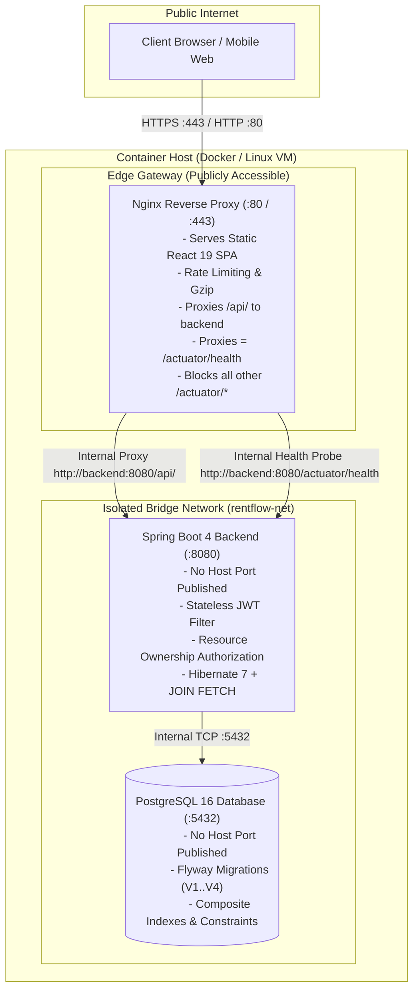

# RentFlow 2.0 — Rental Property Management Platform

[](https://github.com/iiitsourabh-a11y/RentFlow2.0/actions/workflows/ci.yml)
[](https://openjdk.org/projects/jdk/21/)
[](https://spring.io/projects/spring-boot)
[](https://www.postgresql.org/)
[](https://react.dev/)
[](https://www.typescriptlang.org/)
[](backend/src/test)
[](LICENSE)

A full-stack, enterprise-grade rental property management platform built with **Java 21**, **Spring Boot 4**, **PostgreSQL 16**, and **React 19 / TypeScript**. Designed with a security-first architecture featuring stateless JWT authentication, defense-in-depth authorization, N+1 query elimination, automated database migrations, network isolation, and 47 automated integration and unit tests.

---

## 🏗️ System Architecture

### Production Topology (Isolated Docker Network)

In production, RentFlow enforces a **single-entrypoint architecture**. The Spring Boot application server and PostgreSQL database are completely shielded from the public internet inside a private Docker bridge network (`rentflow-net`). Only the hardened Nginx reverse proxy accepts external traffic.



---

## 🔒 Security Architecture & Hardening Highlights

| Control Area | Production Implementation |
|---|---|
| **Secret Management** | Strictly requires environment-provided `JWT_SECRET` (256-bit Base64) and `DB_PASSWORD`. Zero hardcoded fallback secrets in production configuration; application fails startup immediately if missing or weak. |
| **Network Perimeter** | Backend port 8080 and PostgreSQL port 5432 are **not** published to the host machine. Nginx acts as the sole ingress point. |
| **Operational Hardening** | Actuator endpoints are locked down. Nginx proxies strictly `GET = /actuator/health` and explicitly returns `404` for all other `/actuator/*` paths (preventing leakage of env, heap dumps, or beans). |
| **Verified Builds** | Production Dockerfiles compile and run the full 47-test suite inside the multi-stage builder. Broken code cannot produce a deployable container image. |
| **Multi-Tenant Isolation** | Resource-level ownership checks (`requireOwnership(property, owner)`) in the service layer prevent unauthorized editing or deletion of other owners' listings. |
| **Password Hashing** | BCrypt hashing with standard salt rounds for all user credentials. Passwords are never returned in DTOs or logs. |
| **Container Security** | The backend container runs as an unprivileged, non-root user (`rentflow:rentflow`) on Alpine Linux. |

---

## 🛠️ Technology Stack

### Backend
- **Java 21 (LTS)** — Modern Java features including Records, Pattern Matching, and Sealed Classes.
- **Spring Boot 4.1.1** — Dependency injection, autoconfiguration, and modern REST architecture.
- **Spring Security** — Stateless filter chain with HMAC-SHA256 JWT validation (`io.jsonwebtoken 0.12.6`).
- **Spring Data JPA & Hibernate 7** — Declarative persistence with JPQL `JOIN FETCH` queries, composite indexing, and `@EnableSpringDataWebSupport(VIA_DTO)`.
- **Jakarta Bean Validation** — Declarative constraints on DTOs (`@NotBlank`, `@DecimalMin`, `@Email`).
- **Flyway 12** — Versioned migrations (`V1` users, `V2` properties, `V3` search indexes, `V4` inquiries) applied automatically on startup.
- **H2 Database** — In-memory database with PostgreSQL compatibility mode for isolated, high-speed test execution.

### Frontend
- **React 19** — Component-based architecture with hooks and functional components.
- **TypeScript 6** — Strict end-to-end type contracts matching backend DTO schemas.
- **Vite 8** — Production bundler with lightning-fast Hot Module Replacement (HMR).
- **Axios** — Centralized HTTP client with automatic JWT bearer token injection.
- **Lucide React** — Lightweight, accessible SVG icons.
- **Oxlint** — Ultra-fast Rust-based linter (0 errors, 0 warnings).

### Infrastructure & DevOps
- **Docker & Docker Compose** — Multi-stage Alpine containerization with network isolation.
- **Nginx Alpine** — Single entry point reverse proxy and static asset server with Gzip compression.
- **GitHub Actions** — Continuous Integration verifying backend tests, frontend linting, TypeScript compilation, and container builds on every push.

---

## 🚀 Key Functional Features

1. **Public Property Discovery & Filtering**
   - Paginated property catalog (`/api/v1/properties`) with city, minimum rent, and maximum rent filters.
   - Accessible to anonymous users without requiring authentication.
   - Database queries optimized with composite indexes `(available, city, rent_amount)`.

2. **Role-Based Authentication & Authorization**
   - User registration with `TENANT` and `OWNER` roles.
   - Stateless JWT tokens (1-hour expiration) with role claims.
   - Protected endpoints require bearer tokens; invalid or expired tokens are rejected.

3. **Owner Listing Management**
   - Property creation, modification, and deletion restricted strictly to verified `OWNER` accounts.
   - Multi-tenant ownership verification prevents owners from modifying another owner's listing.

4. **Inquiries & Communication Workflow**
   - Tenants can submit inquiries on available properties (`POST /api/v1/inquiries/property/{id}`).
   - Owners can review incoming inquiries and change status to `ACCEPTED` or `REJECTED`.
   - Tenants can track the real-time status of their sent inquiries.

---

## 📋 REST API Reference

### Public Endpoints
| Method | Path | Description | Access |
|---|---|---|---|
| `GET` | `/actuator/health` | Service liveness probe (minimal JSON) | Public |
| `GET` | `/api/v1/health` | Application status probe | Public |
| `POST` | `/api/v1/auth/register` | Register new `TENANT` or `OWNER` account | Public |
| `POST` | `/api/v1/auth/login` | Authenticate and obtain JWT token | Public |
| `GET` | `/api/v1/properties` | Paginated search of available properties | Public |
| `GET` | `/api/v1/properties/{id}` | Detailed property information | Public |

### Protected Endpoints (Requires `Authorization: Bearer <token>`)
| Method | Path | Description | Required Role |
|---|---|---|---|
| `GET` | `/api/v1/auth/me` | Current authenticated user profile | Any authenticated user |
| `POST` | `/api/v1/properties` | Create new property listing | `OWNER` |
| `PUT` | `/api/v1/properties/{id}` | Update listing (resource owner only) | `OWNER` |
| `DELETE` | `/api/v1/properties/{id}` | Delete listing (resource owner only) | `OWNER` |
| `POST` | `/api/v1/inquiries/property/{propertyId}` | Submit inquiry for a property | `TENANT` |
| `GET` | `/api/v1/inquiries/sent` | View tenant's sent inquiries | `TENANT` |
| `GET` | `/api/v1/inquiries/received` | View inquiries for owner's properties | `OWNER` |
| `PATCH` | `/api/v1/inquiries/{id}/status` | Accept or reject an inquiry | `OWNER` |

---

## 💻 Local Development Setup

### Prerequisites
- **JDK 21** installed and configured in `PATH`.
- **Node.js 20+** and `npm`.
- **Docker** (optional, for local PostgreSQL container).

### 1. Database Setup
Start a local PostgreSQL 16 container:
```bash
# Linux / macOS / Windows
docker compose up -d postgres
```
*(The local PostgreSQL service listens on `127.0.0.1:5433` with database `rentflow` and username `rentflow_user`)*.

### 2. Configure Environment
```bash
# Linux / macOS
cp .env.example .env

# Windows PowerShell
Copy-Item .env.example .env
```

### 3. Run the Backend
The Maven wrapper automatically boots the application with the `dev` profile enabled for local development:

```bash
# Linux / macOS
cd backend
./mvnw spring-boot:run

# Windows PowerShell
cd backend
.\mvnw.cmd spring-boot:run
```
*Flyway automatically executes migrations `V1` through `V4` on startup. The API is accessible at `http://localhost:8080`.*

### 4. Run the Frontend
In a separate terminal:

```bash
# Linux / macOS
cd frontend
npm install
npm run dev

# Windows PowerShell
cd frontend
npm.cmd install
npm.cmd run dev
```
Open `http://localhost:5173` in your browser.

---

## 🧪 Automated Testing

RentFlow 2.0 includes **47 automated tests** covering security boundaries, unit logic, and full Spring Boot integration journeys:

```bash
# Linux / macOS
cd backend
./mvnw test

# Windows PowerShell
cd backend
.\mvnw.cmd test
```

### Test Suite Summary:
- **`AuthControllerIT` (14 tests)**: Registration validation, duplicate email detection, admin role escalation prevention, password hashing, JWT generation, and `/me` endpoint security.
- **`PropertyControllerIT` (15 tests)**: Anonymous search, pagination, city filtering, price range queries, owner property creation, tenant restriction, and resource-level isolation.
- **`InquiryControllerIT` (7 tests)**: Tenant inquiry submission, owner dashboard queries, status transition validation (`ACCEPTED`/`REJECTED`), cross-owner access isolation.
- **`JwtServiceTest` (9 tests)**: Cryptographic signature verification, key tampering detection, expired token rejection, claim extraction, fail-fast blank key validation, sub-256-bit key rejection, and Base64 format validation.
- **`HealthControllerIT` (2 tests)**: Liveness and readiness endpoints.

### Frontend Linting & Build Verification:
```bash
# Linux / macOS / Windows
cd frontend
npm run lint    # Runs oxlint (0 errors, 0 warnings)
npm run build   # Type checks with tsc and builds production bundle
```

---

## 🐳 Production Deployment (Docker Compose)

Deploy the entire production-hardened stack (PostgreSQL + Spring Boot + Nginx + React) with full network isolation:

### Step 1: Generate Cryptographic Secrets
Generate a secure 256-bit (32 bytes) Base64 secret key:
```bash
# Linux / macOS
openssl rand -base64 32

# Windows PowerShell
[Convert]::ToBase64String((1..32 | ForEach-Object { Get-Random -Minimum 0 -Maximum 256 }))
```

### Step 2: Configure Production `.env`
Create `.env` from template and populate required variables:
```ini
DB_NAME=rentflow
DB_USERNAME=rentflow_user
DB_PASSWORD=your_strong_generated_db_password
JWT_SECRET=your_generated_base64_jwt_secret
FRONTEND_PORT=80
CORS_ALLOWED_ORIGINS=http://your-domain.com
```

### Step 3: Launch Containers
```bash
# Build and run containers in detached mode
docker compose up -d --build

# Verify container health
docker compose ps
```

In this production deployment:
- **Web App & Gateway**: Accessible at `http://your-domain.com` (or `http://localhost:5173`)
- **Health Check**: `http://localhost:5173/actuator/health`
- **Backend & Database**: Fully hidden within the internal Docker bridge network (`rentflow-net`) with zero public port mappings.

---

## 💡 Technical Interview Highlights

- **Elimination of N+1 Queries**: Optimized repository queries with JPQL `JOIN FETCH` projections for property owners and inquiries, combined with separate `countQuery` definitions for Spring Data pagination.
- **Defense-in-Depth Authorization**: URL-level filter chain security complemented with programmatic service-layer ownership validation (`requireOwnership(property, owner)`).
- **Graceful Error Architecture**: Centralized `@RestControllerAdvice` translates validation exceptions and HTTP errors into standardized JSON error responses with detailed field-level feedback.
- **Stateless Authentication Model**: Zero server-side session state (`SessionCreationPolicy.STATELESS`), allowing seamless horizontal scaling behind cloud load balancers.
- **Safe Schema Evolution**: Sequential Flyway migrations ensuring repeatable database schemas across development, continuous integration, and production environments.
